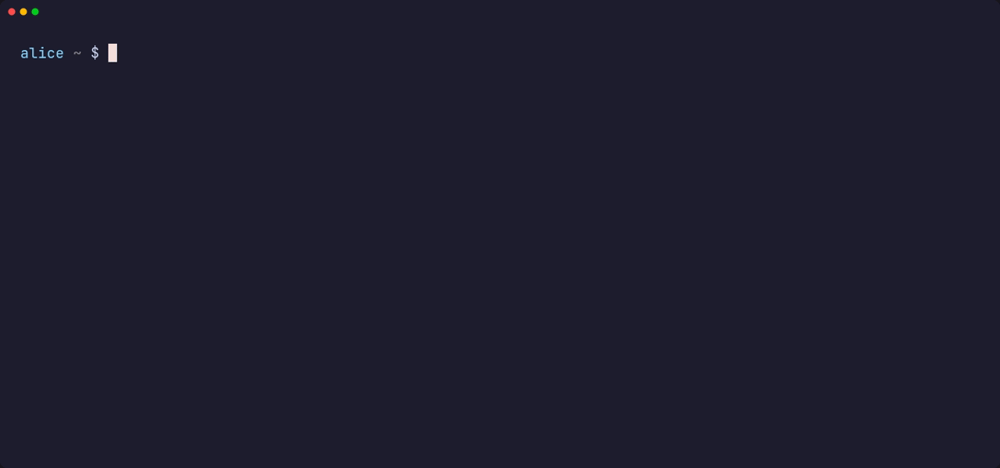

<div align="center">

# 🔐 tacitty

**Password aliases for your terminal.**<br>
Type `@prod-db` at any password prompt and the real secret is sent instead.

[](https://github.com/Sriramm07/tacitty/actions/workflows/ci.yml)
[](https://github.com/Sriramm07/tacitty/releases/latest)
[](#-install)
[](https://www.rust-lang.org)
[](LICENSE)



</div>

---

## ✨ Why tacitty?

Long, random passwords are safe but painful to type. Copy-pasting them leaks
them into clipboard managers, and typing them invites typos and shoulder
surfers. tacitty lets you type a short, memorable alias instead. It works at
**any** terminal password prompt: `sudo`, `su`, `ssh`, `psql`, `mysql`,
`gpg`, `read -s`, Python's `getpass` and more.

- 🎯 **Only at real password prompts.** Type `@prod-db` in a normal shell
  line, in `vim` or in `less`, and it stays plain text.
- 🔒 **Local and encrypted.** Secrets live in an
  [`age`](https://github.com/str4d/rage)-encrypted vault on your machine.
  Unlock it once and it locks itself again after 15 minutes of inactivity.
- 🙈 **Nothing to snoop on.** No clipboard, no keystroke injection, no
  global keyboard hooks, and nothing in your shell history or scrollback.
- 🌐 **Works over SSH too.** Prompts from remote hosts inside `ssh`,
  `mosh`, `docker exec` or `kubectl exec` sessions are recognised as well.
- ⚡ **Zero setup.** One static binary. `tacitty init` turns it on for every
  new terminal automatically.

## 🚀 Quick start

```sh
# 1. Install (x86_64 or ARM64 Linux, no root needed)
curl -fsSL https://raw.githubusercontent.com/Sriramm07/tacitty/main/install.sh | sh

# 2. Create your vault and turn on auto-start
tacitty init

# 3. Save a secret under an alias
tacitty add prod-db
```

Open a new terminal, and use it at any password prompt:

```console
$ sudo systemctl restart nginx
[sudo] password for sriram: @prod-db⏎     ← nothing is shown; sudo receives the real password
```

The first time you use an alias in a session, tacitty asks for your master
passphrase to unlock the vault.

## 📦 Install

The installer downloads the prebuilt binary for your architecture from
[GitHub Releases](https://github.com/Sriramm07/tacitty/releases/latest),
**verifies its SHA-256 checksum**, and installs it to `~/.local/bin`:

```sh
curl -fsSL https://raw.githubusercontent.com/Sriramm07/tacitty/main/install.sh | sh
```

| Option | How |
|---|---|
| Specific version | `TACITTY_VERSION=v0.1.0` before `sh` |
| Different location | `TACITTY_INSTALL_DIR=/some/dir` before `sh` |
| By hand | Download `tacitty-<version>-<arch>-unknown-linux-musl.tar.gz` from the release page, check it against its `.sha256`, and put `tacitty` on your `PATH` |
| From source | See [Building from source](#-development) |

tacitty is a single static binary with no dependencies, so it runs on any
Linux distribution.

**Updating:** run `tacitty update`, or `tacitty update --check` to only see
whether a newer version exists. It verifies the checksum and makes sure the
new binary runs before replacing the old one.

## 🧭 How it works

```
 you type ──► tacitty (pty wrapper) ──► sudo / ssh / psql / ...
               │
               ├─ normal line?           pass every key through untouched
               └─ password prompt?       "@prod-db⏎"  ──►  real secret + ⏎
                     ▲
                     └── is the terminal in "hidden input" mode right now?
```

tacitty runs your shell inside a pseudo-terminal it controls. When you start
typing a line, it checks the terminal's mode. Programs that read passwords
switch the terminal to **canonical mode with echo off**. That's how the
password stays hidden while you type it. tacitty only expands `@alias` in
exactly that mode:

```
secret_mode = !(c_lflag & ECHO) && ((c_lflag & ICANON) || (c_lflag & ECHONL))
```

Editors, pagers and other full-screen programs also turn echo off, but they
run in **raw** mode, so they never match. That's what keeps `@alias` inert
everywhere else. The same detection model is used by
[Ghostty](https://ghostty.org)'s lock indicator and the
[ghostel](https://github.com/telesoho/ghostel) Emacs terminal.

<details>
<summary><b>Prompts on remote hosts (ssh, mosh, docker, kubectl)</b></summary>
<br>

Inside an interactive `ssh` (or `mosh`, `telnet`, `docker exec -it`,
`kubectl exec -it`) session, your *local* terminal is in raw mode, so the
check above can't see the remote host's prompt. As a fallback, tacitty
watches the output. If the program in the foreground is on an allow-list,
and the current line looks like a password prompt (default regex:
`(password|passphrase|passcode|pin)...:\s*$`), it treats `@alias` there as a
password too.

By default (`remote.mode = "auto"`) the secret is sent straight away. This
fallback is a heuristic: if a remote line looks like a prompt but the remote
program is actually showing what you type, the secret would be visible
there. To be asked `send secret for @alias? [y/N]` first, set
`remote.mode = "confirm"`. To turn the fallback off, set `"off"`.

</details>

## ⚙️ Auto-start

`tacitty init` makes every new interactive terminal start inside tacitty:
new tabs and windows, after a reboot, and SSH logins to this machine. It:

- copies the binary to `~/.local/bin/tacitty` (skipped for installs under
  `/usr` or `/opt`), so it keeps working if the downloaded file is moved;
- adds a marked `# >>> tacitty autostart >>>` block to `~/.bashrc` and/or
  `~/.zshrc`.

Your login shell is **not** changed. Scripts, `scp`, cron jobs and
`ssh host cmd` never go through tacitty, because the hook only runs for
interactive terminals. If tacitty fails to start, for example because of a
bad config file, you get your normal shell with a warning, so it can never
lock you out.

| To... | Run |
|---|---|
| Turn auto-start off / on | `tacitty disable` / `tacitty enable` |
| Skip it for one shell | `NO_TACITTY=1 bash` |
| Skip it for a whole login session | add `export NO_TACITTY=1` to `~/.profile` |
| Create the vault without auto-start | `tacitty init --no-autostart` |

> [!NOTE]
> Auto-start supports **bash** and **zsh**. For other shells, run
> `tacitty shell` or set your terminal's command to `tacitty shell`.
> **For tmux**, wrap each *pane* rather than the tmux client: see
> [`contrib/tacitty.tmux.conf`](contrib/tacitty.tmux.conf).

## 📖 Commands

| Command | What it does |
|---|---|
| `tacitty init [--no-autostart]` | Create the vault, set the master passphrase, enable auto-start |
| `tacitty add <alias>` | Store a secret (typed hidden, confirmed twice) |
| `tacitty add <alias> --generate [--length N]` | Store a newly generated random secret |
| `tacitty rm <alias>` | Remove an alias |
| `tacitty mv <old> <new>` | Rename an alias |
| `tacitty ls` | List aliases and dates (never secrets) |
| `tacitty get <alias> [--force]` | Print a secret to stdout (refuses a terminal without `--force`) |
| `tacitty shell [-- <cmd> ...]` | Run your shell (or `<cmd>`) inside tacitty |
| `tacitty enable` / `disable` | Turn auto-start on or off |
| `tacitty lock` / `unlock` / `status` | Lock, unlock or check the vault |
| `tacitty update [--check]` | Update to the latest release |
| `tacitty doctor` | Check that everything is set up correctly |
| `tacitty config` | Print the config file path |

Alias names: letters, digits, `.`, `_`, `/` and `-`, up to 64 characters,
starting with a letter or digit.

## 🛠️ Configuration

Optional. Create `~/.config/tacitty/config.toml`. Every field is shown here
with its default:

```toml
trigger = "@"               # the character that starts an alias
backend = "native"          # native | pass | secret-service | command
on_miss = "bell"            # unknown alias: bell | literal
idle_lock_minutes = 15      # lock the vault after this much inactivity
title_indicator = true      # show "tacitty: secret prompt" in the window title

[remote]
mode = "auto"               # auto | confirm | off
processes = ["ssh", "mosh-client", "telnet", "docker", "kubectl", "podman"]
prompt_regex = '(?i)(password|passphrase|passcode|pin)[^\n]*:\s*$'

[pass]
prefix = "tacitty"

[command]
get = "bw get password {alias}"
```

<details>
<summary><b>Backends: where secrets are stored</b></summary>
<br>

| Backend | Storage | Notes |
|---|---|---|
| **`native`** (default) | `~/.local/share/tacitty/vault.age` | One [`age`](https://github.com/str4d/rage)-encrypted file (scrypt passphrase), mode `0600`. A per-user background agent keeps it unlocked until the idle timeout, so you enter the passphrase once per session. |
| **`pass`** | [`pass`](https://www.passwordstore.org/) under `<prefix>/<alias>` | Read-only; manage entries with `pass` itself. |
| **`secret-service`** | GNOME Keyring / KWallet via `secret-tool` | `tacitty add` can write here too. |
| **`command`** | Any command you configure | `{alias}` is substituted, the first line of output is the secret. Run directly, never through a shell, so alias text can't inject commands. |

</details>

## 🛡️ Security

**Protects against:** shoulder surfing; shell history; clipboard sniffers
and clipboard managers; keyloggers watching injected keystrokes (there are
none); expanding an alias into the wrong program; secrets ending up in
logs, core dumps, swap or terminal scrollback.

**Out of scope:** a compromised root account; malicious software running as
your own user that can attach a debugger to tacitty (made harder, but not
prevented); someone who can overwrite the vault or config files.

<details>
<summary><b>What tacitty does about it</b></summary>
<br>

- Secrets never touch command-line arguments, environment variables, the
  clipboard, disk (except the encrypted vault), logs, or the output stream.
- The wrapper and agent turn off core dumps and debugger attachment at
  startup (`PR_SET_DUMPABLE=0`, `RLIMIT_CORE=0`).
- Every buffer that holds a secret is wiped as soon as it's no longer
  needed (`zeroize`), locked into memory where possible (`mlock`), and never
  printed in debug output.
- `TACITTY_LOG` records fixed status labels only, never input, aliases or
  secrets. The logging function only accepts compile-time constant strings,
  so this is enforced by the compiler.
- Secrets are only written to the terminal while it's in password mode
  (or at a detected remote prompt).
- Your terminal's settings are restored on every exit path, including
  crashes and signals.
- Vault file `0600`, directory `0700`. tacitty refuses to open a vault that
  other users can read, or that you don't own.
- The agent's socket checks each caller's user ID and rejects everyone
  else. Like `ssh-agent`, other programs running as *you* can query it
  while the vault is unlocked.
- `cargo audit` and `cargo deny` run in CI on every push. `openssl` is
  banned from the dependency tree; all cryptography is pure Rust (`age`,
  `chacha20poly1305`, `scrypt`).

</details>

<details>
<summary><b>Known limitations</b></summary>
<br>

- **gpg's default pinentry** (`pinentry-curses`, `pinentry-gnome3`) runs in
  raw mode or as a GUI, so tacitty can't see it. Set gpg-agent's
  `pinentry-program` to `pinentry-tty` to use aliases at gpg prompts.
- **tmux / screen:** if tacitty wraps the tmux *client*, it only sees
  tmux's own raw terminal. Run tacitty inside each pane instead (see
  `contrib/tacitty.tmux.conf`).
- Programs that read passwords in raw mode with their own masking (rather
  than the terminal's built-in hidden input) aren't detected.
- The remote-prompt fallback is a heuristic and could, in principle, match
  a line that isn't really a password prompt. Use `remote.mode = "confirm"`
  if you want a confirmation first.
- A program can print its prompt a split second before it actually hides
  input. tacitty briefly re-checks right after new output to narrow this
  window, but extremely fast or scripted input could still land in it.
- Windows and macOS aren't supported. GUI apps and browser forms are out of
  scope; tacitty is not a full password manager.

</details>

## 🧑‍💻 Development

Requires Rust 1.80+.

```sh
cargo build --release                                  # build
cargo test --lib                                       # unit + randomized robustness tests
cargo test --test integration -- --test-threads=1     # drive the real binary through real ptys
```

The integration tests run one at a time on purpose: each starts its own
background agent, and running many at once on a slow machine adds enough
timing jitter to make results flaky. See [`fuzz/README.md`](fuzz/README.md)
for the fuzz targets.

<details>
<summary><b>Static builds, releases and the demo</b></summary>
<br>

- **Static binary:** `rustup target add x86_64-unknown-linux-musl`, then
  `cargo build --release --target x86_64-unknown-linux-musl`.
- **Releases:** pushing a tag like `v0.1.0` (it must match `Cargo.toml`)
  runs `.github/workflows/release.yml`, which publishes static binaries for
  x86_64 and aarch64 with `.sha256` checksums. `install.sh` and
  `tacitty update` install from these.
- **Arch Linux:** `packaging/PKGBUILD`.
- **Demo GIF:** recorded with [VHS](https://github.com/charmbracelet/vhs)
  from [`assets/demo/demo.tape`](assets/demo/demo.tape). Re-record with
  `sh assets/demo/record.sh` (needs Docker).

</details>

## 📄 License

Copyright © 2026 Sriram P.

tacitty is source-available under the
[PolyForm Noncommercial License 1.0.0](LICENSE).

| ✅ Allowed | ❌ Not allowed |
|---|---|
| Personal use, hobby projects, study and research | Selling it, or bundling it into a paid product or service |
| Use by charities, schools and government bodies | Using it inside a for-profit business |
| Modifying and sharing it for noncommercial purposes | |

For a commercial license, contact **sriram_297@yahoo.com**.
